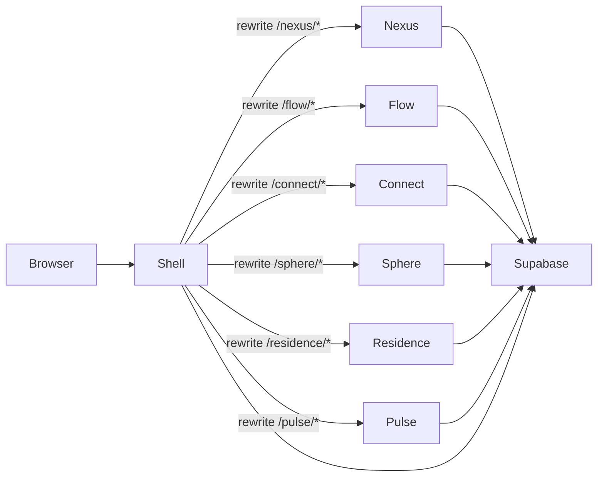

# Architecture

## Goals

Campuz360 is a **vertical (route-based) microfrontend** campus platform. Each module is an independently deployable Next.js app. One shared Supabase project provides Auth, Postgres, Storage, and RLS. A Shell host composes modules behind one domain via HTTP rewrites.

> [!IMPORTANT] Not Module Federation
> Remotes are full Next.js apps with `basePath`, not remote entry chunks. Do not introduce Webpack Module Federation unless mentors rewrite this handbook.

## High-level diagram



## Monorepo layout

```tree
campuz360/
├── apps/
│   ├── shell/          # host: layout, rewrites, handbook, dashboard
│   ├── nexus/          # identity & access
│   ├── flow/           # workflows / leave
│   ├── connect/        # notifications & announcements
│   ├── sphere/         # communities
│   ├── residence/      # housing
│   └── pulse/          # events
├── packages/
│   ├── ui/             # brand components
│   ├── auth/           # Supabase SSR + permissions
│   ├── contracts/      # Zod, MODULES, permission keys
│   └── config/         # tsconfig + Tailwind tokens
├── supabase/migrations/
└── docs/               # this handbook
```

## Composition model

| Concern | Owner | Mechanism |
| --- | --- | --- |
| Public URL space | Shell | Next.js `rewrites` in `apps/shell/next.config.ts` |
| Remote asset paths | Each MFE | `basePath` (e.g. `/flow`) |
| Local ports | Each MFE | 3000 Shell … 3006 Pulse |
| Shared session | All apps | Supabase Auth cookies via `@campuz360/auth` |
| Shared UI | All apps | `@campuz360/ui` |
| Shared types/schemas | All apps | `@campuz360/contracts` |

### Shell rewrite env vars

```text
NEXUS_URL, FLOW_URL, CONNECT_URL, SPHERE_URL, RESIDENCE_URL, PULSE_URL
```

Local defaults are `http://localhost:300x`. Production values are whatever URLs your cohort deploys.

## Runtime stack (locked)

- **Next.js App Router** + React 19 + TypeScript
- **Tailwind CSS v4** + Radix via `@campuz360/ui`
- **Supabase** Auth + Postgres + Storage + RLS
- **Zod** in `@campuz360/contracts`
- **pnpm workspaces** + **Turborepo**
- Docs viewer: **Flowdown** in Shell `/handbook`

> [!NOTE] Account-agnostic cloud
> Hosting and Supabase are configured by the cohort on their own accounts. Do not hardcode MentorBridge cloud project IDs.

## Auth & authorization

> [!STEPS] Session path
> 1. **Sign in on Nexus**
>    Supabase email/password.
> 2. **Cookies available to apps**
>    Same parent domain in production; localhost multi-port in DEV.
> 3. **Load permissions**
>    `get_user_permissions(user_id)` RPC.
> 4. **Shell filters nav**
>    UI only — not security.
> 5. **Each MFE enforces on the server**
>    Server Actions + RLS.

## Cross-MFE communication

> [!PROS] Allowed
> - Shared database + RLS
> - Postgres RPC such as `create_notification`
> - Documented HTTP APIs in `packages/contracts` (future)

> [!CONS] Forbidden
> - Importing another app’s React pages/components
> - Calling another app’s private Server Actions
> - Duplicating identity tables outside Nexus

## Delivery sequencing

> [!STEPS] Recommended order
> 1. **Nexus + Shell**
>    Auth + host
> 2. **Flow + Connect**
>    Workflow + notifications
> 3. **Sphere, Residence, Pulse**
>    Domain MFEs
> 4. **Hardening**
>    e2e, advisors, cookie domain

## Definition of Done (platform)

An MFE is “done” for a sprint when:

- [ ] Features match acceptance criteria for committed stories
- [ ] `pnpm typecheck` / lint / unit tests pass for touched packages
- [ ] RLS policies cover new tables
- [ ] Deployed independently behind Shell rewrites
- [ ] No secrets in git; no `service_role` in client code
