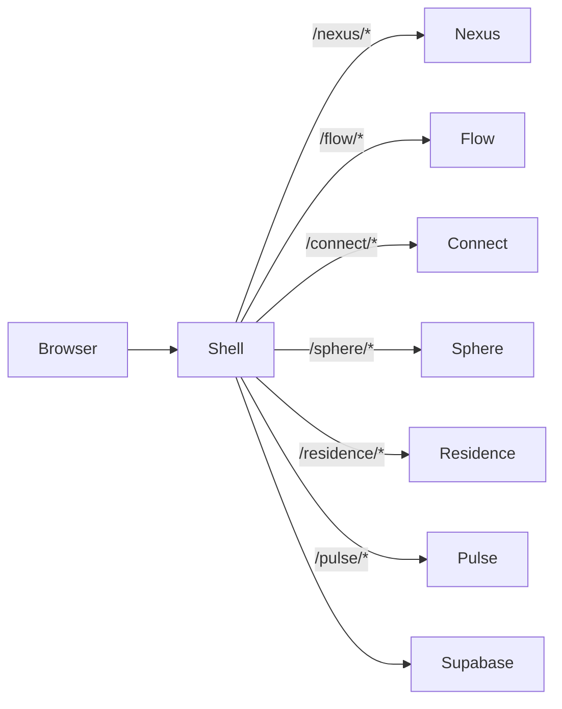

# Shell — host microfrontend

> [!STATS]
> - **Port** `3000`
> - **basePath** none (public site root)
> - **Owns** layout, rewrites, handbook, dashboard, search, PWA stubs

## Campuz360 in one minute

Campuz360 is a **vertical microfrontend** campus platform: seven independently deployable Next.js apps behind one Shell host. Composition uses **HTTP rewrites**, not Module Federation. One shared **Supabase** project provides Auth, Postgres, Storage, and RLS.



> [!IMPORTANT] Shell’s job
> Own the chrome and the URL space. Do **not** own domain tables (leave, housing, events, …).

## What Shell owns

| Concern | Location |
| --- | --- |
| Global layout & permission nav | [`components/ShellLayout.tsx`](../components/ShellLayout.tsx) |
| Dashboard tiles & session summary | [`app/page.tsx`](../app/page.tsx) |
| Handbook (Flowdown) | [`app/handbook/*`](../app/handbook), [`lib/handbook.ts`](../lib/handbook.ts) |
| Cross-module search UI | [`app/search/page.tsx`](../app/search/page.tsx) |
| Rewrites to remotes | [`next.config.ts`](../next.config.ts) |
| 404 / PWA manifest / offline page | [`app/not-found.tsx`](../app/not-found.tsx), [`app/manifest.ts`](../app/manifest.ts), [`public/offline.html`](../public/offline.html) |

## Public routes

| Path | Purpose |
| --- | --- |
| `/` | Dashboard — module tiles filtered by permissions when signed in |
| `/search?q=` | Search Sphere communities and Pulse events (when permitted) |
| `/handbook` | Handbook index |
| `/handbook/[slug]` | Individual handbook doc |

## How rewrites work

Shell proxies module prefixes to remote origins (local ports by default):

| Prefix | Env var | Default |
| --- | --- | --- |
| `/nexus` | `NEXUS_URL` | `http://localhost:3001` |
| `/flow` | `FLOW_URL` | `http://localhost:3002` |
| `/connect` | `CONNECT_URL` | `http://localhost:3003` |
| `/sphere` | `SPHERE_URL` | `http://localhost:3004` |
| `/residence` | `RESIDENCE_URL` | `http://localhost:3005` |
| `/pulse` | `PULSE_URL` | `http://localhost:3006` |

> [!TABS]
> #### Local
>
> `pnpm dev` starts all apps. Open Shell at `http://localhost:3000`.
>
> #### Production
>
> Deploy each app separately. Point Shell rewrite env vars at those URLs. Students use **their own** hosting accounts.

## Auth & permissions

- Sign-in UX lives in **Nexus** (`/nexus/login`).
- Shell reads the session via `@campuz360/auth/server` (`getUser`, `getUserPermissions`).
- Nav items come from `MODULES` in `@campuz360/contracts`, filtered by permission keys such as `nexus.access`, `flow.access`, …
- When logged out, the dashboard may still show module tiles for discovery; real module pages enforce auth.

> [!STEPS] Typical session
> 1. User opens Shell `/`
> 2. Signs in through Nexus
> 3. Cookies are available to apps under the same site
> 4. Shell filters sidebar + tiles by permissions
> 5. Clicks enter a module path; Shell rewrites to that MFE

## Handbook (this docs system)

Canonical platform docs live in repo [`docs/`](/handbook). Module self-docs live in each `apps/<mfe>/docs/`.

```bash
pnpm handbook:sync   # copies platform + module docs into Shell content/
```

Browse in-app at `/handbook`.

## Dependencies

| Package | Use |
| --- | --- |
| `@campuz360/ui` | Layout primitives, buttons, cards |
| `@campuz360/auth` | Session + permissions |
| `@campuz360/contracts` | `MODULES` catalog |
| `@localix-ai/flowdown` | Handbook Markdown rendering |

## Must not

> [!CAUTION] Boundaries
> - Do not create leave / community / housing / event tables in Shell
> - Do not import React pages from other apps
> - Do not put `service_role` or secrets in `NEXT_PUBLIC_*`

## Related reading

- [Architecture](/handbook/architecture)
- [MFE boundaries](/handbook/boundaries)
- [Feature backlog map](/handbook/backlog)
- Sibling modules: [Nexus](/handbook/module-nexus), [Flow](/handbook/module-flow), [Connect](/handbook/module-connect)
